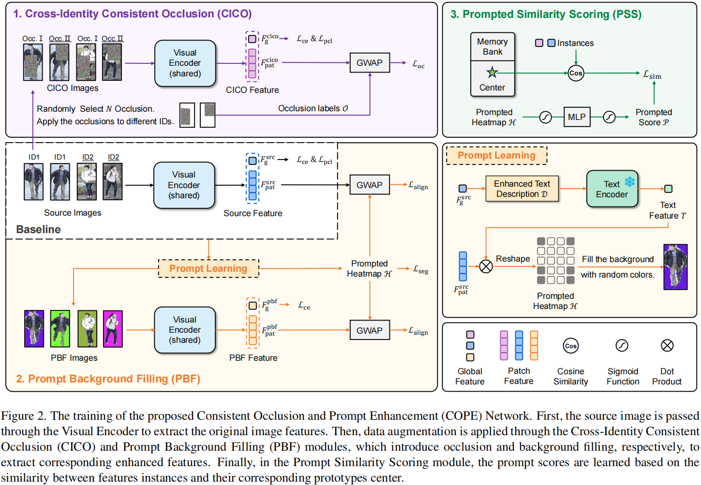
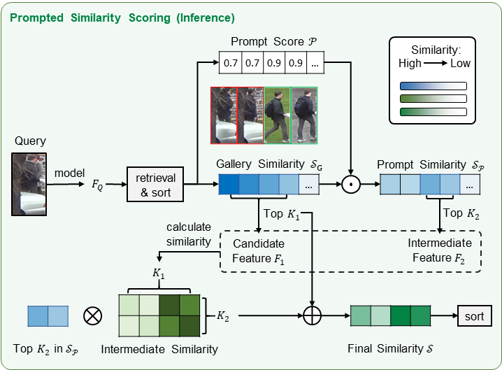

# 🔍 COPE: Consistent Occlusion and Prompt Enhancement Network for Occluded Person Re-Identification

This repository is an independent reproduction and improvement workspace based on
[Cecoming/COPE](https://github.com/Cecoming/COPE), by
[Siyi Sun (Cecoming)](https://github.com/Cecoming) and the original authors.
The original source was imported as a snapshot from commit
[`13ba061`](https://github.com/Cecoming/COPE/commit/13ba061721953653f4aba078d19354f181ea63b0).
The original project documentation and acknowledgements are retained below.

## Introduction

Welcome to the official repository of our CVPR 2026 paper, "_COPE: Consistent Occlusion and Prompt Enhancement Network for Occluded Person Re-Identification_."

COPE is designed for **occluded person re-identification** and delivers strong performance on both occluded and holistic Re-ID benchmarks. ✨

**[NEWS!]** Our paper is available as open access and can be accessed via the [CVPR 2026 Open Access Repository](https://openaccess.thecvf.com/content/CVPR2026/html/Sun_COPE_Consistent_Occlusion_and_Prompt_Enhancement_Network_for_Occluded_Person_CVPR_2026_paper.html).

Key Highlights:

1. COPE consistently outperforms existing methods on **four occluded** and **two holistic** Re-ID datasets.
   🏆 In particular, it achieves **82.4% Rank-1 accuracy** and **76.4% mAP** on the challenging **Occluded-Duke** benchmark.
2. This repository provides the core resources needed for reproduction and evaluation, including dependencies, dataset preparation notes, training and inference entry points, and trained weights.
3. We further provide **transferable post-processing tools** for other Re-ID methods:
   `PSS` can be reused at inference time by exporting gallery prompt scores from COPE, while `NPSS` offers a lightweight **training-free** alternative when human parsing labels are unavailable.

## Table of Contents

- [🔍 COPE: Consistent Occlusion and Prompt Enhancement Network for Occluded Person Re-Identification](#-cope-consistent-occlusion-and-prompt-enhancement-network-for-occluded-person-re-identification)
  - [Introduction](#introduction)
  - [Table of Contents](#table-of-contents)
  - [Pipeline](#pipeline)
    - [Training Stage](#training-stage)
    - [Inference Stage](#inference-stage)
  - [Environment](#environment)
  - [Datasets](#datasets)
    - [Occluded Datasets](#occluded-datasets)
    - [Holistic Datasets](#holistic-datasets)
  - [Human Parsing Labels](#human-parsing-labels)
  - [Weights](#weights)
  - [Training](#training)
  - [Inference](#inference)
  - [PSS and NPSS as Plug-in Post-processing Modules](#pss-and-npss-as-plug-in-post-processing-modules)
    - [Reusing PSS Without Retraining Another Method](#reusing-pss-without-retraining-another-method)
    - [Comparison with Re-ranking on Occluded-DukeMTMC](#comparison-with-re-ranking-on-occluded-dukemtmc)
    - [NPSS: A Training-Free Alternative](#npss-a-training-free-alternative)
    - [NPSS Performance Across Different Backbones](#npss-performance-across-different-backbones)
  - [Acknowledgement](#acknowledgement)

---

## Pipeline

### Training Stage



### Inference Stage



---

## Environment

The training environment uses **uv**, Python 3.10, and PyTorch 2.5.1 with
CUDA 12.1. It targets Linux x86_64 with an NVIDIA GPU. Dependencies are declared
in `pyproject.toml` and pinned in `uv.lock`.

```bash
# Install uv once (https://docs.astral.sh/uv/getting-started/installation/).
curl -LsSf https://astral.sh/uv/install.sh | sh
export PATH="$HOME/.local/bin:$PATH"

# Run from the repository root. uv installs Python and creates .venv as needed.
uv sync --locked

# Verify dependencies, CUDA operations, the tokenizer, and both CLI entry points.
# No weights or datasets are needed for this check.
uv run --locked python scripts/check_environment.py
```

Use `uv run --locked` for training and evaluation; environment activation is not
required. CUDA libraries are installed with PyTorch; the host must provide a
compatible NVIDIA driver. OpenCV uses the headless build so a display server and
`libGL` are not required. The optional, unused `body_part_attention_loss.py`
module depends on external MONAI/torchmetrics/BPBreID code and is not included in
the core training environment.

After changing dependencies, run `uv lock` and `uv sync --locked`, and commit both
`pyproject.toml` and `uv.lock`. Keep `.venv`, downloaded datasets, and weights out
of Git. On AutoDL, the uv download cache can be placed on the data disk with
`export UV_CACHE_DIR=/root/autodl-tmp/uv-cache`.

---

## Datasets

📂 Create a `data` folder under the root directory. Download and unzip the datasets into it:

### Occluded Datasets

- [Occluded-Duke](https://github.com/lightas/Occluded-DukeMTMC-Dataset)
- [Occluded-REID](https://github.com/kevinbro96/ICME2018_Occluded-Person-Reidentification_datasets)
- [P-DukeMTMC-reID](https://github.com/kevinbro96/ICME2018_Occluded-Person-Reidentification_datasets)
- [Partial-REID](https://opendatalab.org.cn/OpenDataLab/Partial-REID)

### Holistic Datasets

- [Market1501](https://drive.google.com/file/d/0B8-rUzbwVRk0c054eEozWG9COHM/view)
- [MSMT17](https://arxiv.org/abs/1711.08565)

---

## Human Parsing Labels

🧩 We use human parsing labels from **[BPBreID](https://github.com/VlSomers/bpbreid)** for five datasets:
Market-1501, Occluded-Duke, Occluded-ReID, P-DukeMTMC, and Partial-REID.
We use the `pifpaf_maskrcnn_filtering` labels, following their file structure:

```text
Market-1501
├── train
├── test
├── masks
│   └── pifpaf_maskrcnn_filtering
├── list_gallery.txt
├── list_query.txt
├── list_train.txt
└── list_val.txt
```

For **MSMT17**, we generated parsing labels using the same pipeline and selected `pifpaf` as the final label source after evaluation.
The expected directory structure is:

```text
MSMT17
├── train
├── test
├── masks
│   └── pifpaf
├── list_gallery.txt
├── list_query.txt
├── list_train.txt
└── list_val.txt
```

📌 **Important**: Set `DATASETS.ROOT_DIR` in the config to your dataset root path — all dataset folders (`Market-1501`, `MSMT17`, etc.) should reside under this directory.

---

## Weights

We provide all released models with a **stride size of 16** to support reproducibility and follow-up research.  
🔗 Download links for **[trained weights](https://drive.google.com/drive/folders/1ekVtlmAv_3mkgQUIM9db6wqCrr0--rNB?usp=sharing)** are available in the model release section. Please refer to `configs/` for the corresponding configuration files.

### Preparing Occluded-Duke

The Occluded-Duke config uses `./data/Occluded_Duke` and
`./weights/cope_occduke.pth`. On a training server, these directories can be
symlinks to the data disk. Keep image archives, parsing labels, and model files
on that server.

Use the original DukeMTMC-reID image archive and the `train.list`, `query.list`,
and `gallery.list` files from the
[official Occluded-Duke repository](https://github.com/lightas/Occluded-DukeMTMC-Dataset/tree/master/Occluded_Duke).
Download the Occluded-Duke parsing-label ZIP from
[BPBreID's labels folder](https://drive.google.com/drive/folders/1DUSKdJxSB-CQ4TfiB2WYJeifOPKMq-a_).
Then run:

```bash
uv run --locked python scripts/prepare_occ_duke.py \
  --images-zip /path/to/DukeMTMC-reID.zip \
  --masks-zip /path/to/Occluded_Duke_masks.zip \
  --split-dir /path/to/official-split-lists \
  --output data/Occluded_Duke \
  --report results/data-preparation/occ_duke.json
```

The script verifies archive coverage before extraction, checks sample images
and parsing arrays, and records split counts and SHA-256 hashes. It includes
the gallery-to-query reassignment required by the official split. Images and
mask arrays are written only to `--output`; the small JSON report can be kept
with experiment results. Re-running extraction replaces matching output files.

Download `cope_occduke.pth` from the COPE weights folder above. The model also
needs the original OpenAI CLIP `ViT-B-16.pt`; it is cached automatically in
`~/.cache/clip` on the first model load. That cache can also be symlinked to the
data disk.

### Reproduced verification

The released checkpoint was evaluated with the procedure above on a prepared
Occluded-Duke split. All 35,489 list entries (15,618 train / 2,210 query /
17,661 gallery) had a matching image and parsing label:

| Setting | Rank-1 | mAP |
| --- | ---: | ---: |
| `configs/OCC_Duke/cope.yml` (PSS) | 82.0 | 75.3 |

Archive checksums and split statistics are recorded in
`results/data-preparation/occ_duke.json`; the evaluation log is in
`results/evaluation/occ_duke_eval.log`.

---

## Training

🚀 Train COPE with:

```bash
uv run --locked python train_cope.py --config_file configs/<target_dataset>/cope.yml
```

Example for **Occluded-Duke**:

```bash
uv run --locked python train_cope.py --config_file configs/OCC_Duke/cope.yml
```

Please make sure that the dataset path, human parsing labels, and output settings in the configuration file are correctly prepared before training.

---

## Inference

🔍 Evaluate a downloaded model with:

```bash
uv run --locked python test_cope.py --config_file configs/<target_dataset>/cope.yml
```

Example for **Occluded-Duke**:

```bash
uv run --locked python test_cope.py --config_file configs/OCC_Duke/cope.yml
```

🔧 Ensure that `TEST.WEIGHT` in the `.yml` configuration points to the downloaded checkpoint.

Configuration files for all datasets are available in `configs/<target_dataset>/`.
⚠️ **Note**: Please download and prepare the **human parsing labels** before starting training.

---

## PSS and NPSS as Plug-in Post-processing Modules

✨ We also provide two practical post-processing modules that can be reused in other Re-ID pipelines.

### Reusing PSS Without Retraining Another Method

If you would like to apply **PSS** to another method at inference time, but do not want to migrate the full PSS training process, we recommend the following workflow:

1. Train COPE once on the target dataset.
2. During COPE inference, save the prompt scores of all gallery samples.
3. During inference of another method, load the saved gallery prompt scores and reuse them directly for PSS-based post-processing.

This strategy allows you to benefit from PSS without changing the training procedure of the target method. The implementation is available in `utils/metrics_PSS.py`.

### Comparison with Re-ranking on Occluded-DukeMTMC

The table below compares standard re-ranking and PSS-based post-processing on **Occluded-DukeMTMC**. For COPE, PSS offers a stronger balance between accuracy and inference cost, while remaining easy to transfer to other methods.

| Index | Setting | Rank-1 | mAP | Inference Time |
| --- | --- | ---: | ---: | ---: |
| 1 | CLIP-REID | 67.2 | 60.3 | 41.9s |
| 2 | 1 + Re-ranking | 72.5 | 74.2 | 179.1s |
| 3 | 1 + PSS | 75.1 | 68.8 | 45.3s |
| 4 | ProFD | 70.3 | 63.3 | 128.3s |
| 5 | 4 + Re-ranking | 74.0 | 75.9 | 243.6s |
| 6 | 4 + PSS | 78.9 | 72.7 | 132.3s |
| 7 | COPE (w/o PSS) | 76.8 | 68.9 | 42.3s |
| 8 | 7 + Re-ranking | 81.1 | 81.6 | 173.7s |
| 9 | 7 + PSS (COPE) | **82.1** | 75.4 | **51.5s** |

### NPSS: A Training-Free Alternative

If you would like to apply a similar post-processing strategy on other datasets but do not have human parsing labels for training, you can use **NPSS**, a training-free **Non-Prompt Similarity Scoring** module.

NPSS is designed to be plug-and-play: it introduces only lightweight computation while still bringing clear performance gains in practice. The implementation is available in `utils/metrics_NPSS.py`.

### NPSS Performance Across Different Backbones

The following results show that NPSS consistently improves different backbones while keeping the additional inference overhead small.

| Index | Setting | Rank-1 | mAP | Inference Time |
| --- | --- | ---: | ---: | ---: |
| 1 | COPE (without PSS) | 76.8 | 68.9 | 42.30s |
| 2 | 1 + PSS (COPE) | 82.1 | 75.4 | 51.56s |
| 3 | 1 + NPSS | 80.1 | 74.6 | 44.42s |
| 4 | CLIP-REID (CNN) | 59.8 | 52.9 | 23.99s |
| 5 | 4 + NPSS | 66.6 | 61.7 | 31.07s |
| 6 | CLIP-REID (ViT) | 67.3 | 60.1 | 43.70s |
| 7 | 6 + NPSS | 71.4 | 67.2 | 46.84s |

---

## Acknowledgement

🙏 This codebase is built upon the excellent work of the following projects. We sincerely thank the authors for their contributions to the Re-ID community!

1. [TransReID](https://github.com/damo-cv/TransReID)
2. [CLIP-ReID](https://github.com/Syliz517/CLIP-ReID)
3. [PCL-CLIP](https://github.com/RikoLi/PCL-CLIP)
4. [BPBreID](https://github.com/VlSomers/bpbreid)

